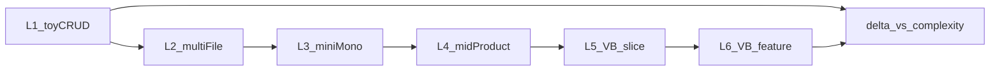

# Ledgernomics complexity-ladder A/B — study plan

Scientific paired A/B of **with Ledgernomics MCP** vs **without**, across a **six-level complexity ladder** ending in a real VictoryBowling feature. Paid API model for **all six levels** (one fixed frontier/mid-frontier model both arms). Off-hours start/pause controller. Live harness/Ledgernomics bugfixes during runs.

**Status:** plan only — not executed.  
**Experiment root (to create later):** `experiments/complexity-ladder-ab/`  
**Product under test:** this repo (`ledgernomics` stdio MCP).  
**Real-product reference:** `D:\Nimbus Labs LLC\VictoryBowling\bowling_tournament_app` (~160k backend Python LOC + ~190k FE TS/TSX).

---

## Defaults locked

| Decision | Choice |
|----------|--------|
| Metering backend | **Paid API for L1–L6** (Anthropic or OpenAI-compatible). Same **model id** for every level and both arms. |
| Default model (unless overridden in config) | **Claude Sonnet 5** (list ~$2/M input, $10/M output). Haiku / Sonnet 4.6 / Opus are cost alternatives in the estimate table. |
| Primary metrics | Prompt tokens, completion tokens, turns, wall time, **$ at list price** |
| Secondary | Quality rubric (0–2 × 5 dims); incomplete rate |
| Replication | **n = 12 paired trials per level** (12 with + 12 without = **24 arms/level**, **144 arms** total) |
| Host safety | Serial arms only; pause if system CPU or RAM ≥ **80%** |
| VictoryBowling | **Never** write the live checkout. L6 = fresh **git worktree** under the experiment root per trial |
| Live hardening | Treat as soak test: fix harness + Ledgernomics bugs when found; invalidate + re-queue contaminated trials |

No Cursor billing paste-back. No mixing models within the primary cohort.

---

## Why this design

Toy MVPs previously showed **ledger overhead** (protocol tax) on tiny tasks. The claim to test is a **crossover**: as task complexity rises, median Δ tokens (with − without) should move from positive (overhead) toward negative (savings) at comparable quality.

Paid models on **all** levels keep capability constant so the X-axis is **complexity**, not “7B failed L6.” External validity is to frontier coding agents, not to local 7B.



---

## Levels (6)

Complexity labels are **spec-defined** (pre-declared). Record per level: target files, estimated LOC, domains, slices, and Halstead/cyclomatic on a **golden reference implementation** — not on thrash output.

| Level | Name | Spec shape | Acceptance | Complexity intent |
|------:|------|------------|------------|-------------------|
| **L1** | Toy CRUD | Single FastAPI+SQLite+1 HTML page; 1 entity | Import + ≥2 routes + HTML + README gate | Overhead baseline |
| **L2** | Multi-file app | FastAPI+SQLite+HTML; 2–3 entities, filters, validation | Gate + smoke pytest | Mild plan sprawl |
| **L3** | Mini monorepo | `backend/` FastAPI + `frontend/` Vite React; shared API; one vertical feature | BE tests + FE build + one smoke | Cross-package coordination |
| **L4** | Mid product | L3 + API-key auth, migration, ≥2 packages, **mid-run requirement change** at turn N | Tests must pass **after** change | Churn + longer episode |
| **L5** | VB-shaped slice | Self-contained seed (~3–8k LOC) mirroring VB patterns (rounds/standings-like domain, service layer, React page) | Domain tests + FE smoke | Proxy for VB without full monorepo |
| **L6** | Real VB feature | Worktree of bowling app; one significant feature; path allowlist | Feature tests + targeted FE/API smoke; **not** full CI | Real product |

### L6 feature (concrete)

**Event lifecycle status consistency for Standings** (from existing product handoff): directors see coherent “live vs done” on Standings matching Event Info / `final_nodes_completed` semantics — FE chrome + BE hydration so ORM/report paths agree.

- Spec cites: `D:\Nimbus Labs LLC\VictoryBowling\bowling_tournament_app\EVENT_STATUS_COMPLETENESS_HANDOFF_2026-09-22.md`
- Harness enforces an allowlisted write set (standings services, event reports, related React standings components) on **both** arms.
- Acceptance: unit tests for computed status hydration + focused FE/API assertion. Full monorepo CI is out of scope for the stop rule.

---

## Paid model tiers (reference)

| Tier | Examples | Role in this study |
|------|----------|--------------------|
| Light frontier | Claude Haiku 4.5, Gemini Flash, GPT-4.1-mini | Cheaper cohort; may struggle at L6 |
| **Default** | **Claude Sonnet 5** (or Sonnet 4.6) | Primary paid cohort for L1–L6 |
| Heavy frontier | Claude Opus 5, GPT-5-class | Optional sensitivity; much higher $ |

One fixed model per analysis cohort. Optional later: a second cohort with a different tier — separate curves, never mixed.

---

## Cost estimate — paid L1–L6 (144 arms)

Assumptions: n=12 pairs/level; ~**85% input / 15% output**; no prompt-cache discount; Anthropic list prices (Sep 2026). Blended ≈ Haiku **$1.60**, Sonnet 5 **$3.20**, Sonnet 4.6 **$4.80**, Opus **$8.00** per MTok.

**Token burn per arm (bands):**

| Level | Optimistic | Expected | Pessimistic |
|------:|-----------:|---------:|------------:|
| L1 | 0.05M | 0.08M | 0.20M |
| L2 | 0.10M | 0.15M | 0.40M |
| L3 | 0.20M | 0.30M | 0.80M |
| L4 | 0.30M | 0.50M | 1.00M |
| L5 | 0.50M | 1.00M | 2.00M |
| L6 | 1.00M | 2.00M | 4.00M |

**Full ladder (24 arms × sum of per-level rates):**

| Scenario | Total tokens (approx.) | Haiku | Sonnet 5 | Sonnet 4.6 | Opus |
|----------|------------------------|------:|---------:|-----------:|-----:|
| Optimistic | ~52M | ~$80 | ~$170 | ~$250 | ~$410 |
| Expected | ~97M | ~$155 | ~$310 | ~$465 | ~$775 |
| Pessimistic (+~20% defect re-runs) | ~250M | ~$400 | ~$800 | ~$1,200 | ~$2,000 |

**Budget takeaway for Sonnet 5 on all six levels:** plan **~$300–800**; hold **~$1k** headroom if thrash + retries spike. Caps (`max_turns` / wall clock) are what keep the pessimistic column from dominating.

---

## Replication and stats

Per level:

- 12 fresh paired trials (new empty/workdir or worktree each time).
- Arm order balanced 6/6 (without→with vs with→without).
- Identical stop rule: acceptance **or** level-scaled `max_turns` / `max_wall_min`.
- Analyze: median Δ tokens/turns; bootstrap 95% CI; paired Wilcoxon; quality-within-1-point filter; incomplete rate; plot Δ% vs level / composite C; **$ column** at list price.

Composite complexity (plotting only):

\[
C = \log(1+LOC_{ref}) + \overline{cyclo}_{ref} + N_{files} + N_{slices} + \mathbf{1}_{midrun}
\]

---

## Experiment layout

```
experiments/complexity-ladder-ab/
  config.toml              # backend=anthropic|openai, model, caps, n_pairs, per-level walls
  controller/              # run / pause / status / resume
  harness/                 # agent, API meter, MCP client, tools, resources
  levels/L1..L6/           # SPEC.md, acceptance checks, optional seed (L5)
  trials/{level}/{pair_id}/{arm}/
  traces/...
  defects/                 # bugfix notes ↔ invalidated trials
  analyze.py
  RESULTS.md
```

Bake in lessons from the scrapped Ollama study: text tool-call parse, mkdir/uvicorn blocks, early `mark_done` rejection, acceptance gates, Windows rmtree locks, L6 path sandbox.

---

## Start / pause controller (off-hours)

CLI (no web UI required):

| Command | Behavior |
|---------|----------|
| `python -m controller run` | Start or resume queue |
| `python -m controller pause` | Set `state/PAUSE`; finish in-flight API request; checkpoint; exit |
| `python -m controller status` | Done / next / pause flag / $ spent so far |
| `python -m controller skip-current` | Mark trial `incomplete_manual` |

```mermaid
stateDiagram_v2
  Idle --> Running: run
  Running --> Paused: pause_flag_seen
  Paused --> Running: run
  Running --> Idle: queue_empty
```

Queue: all `(level, pair_id, arm)` serial. Crash-safe via `summary.json` before dequeue.

---

## Live bugfix policy

1. Pause controller.  
2. Fix Ledgernomics and/or harness.  
3. Log `defects/DEFECT-NNN.md`.  
4. Mark contaminated trials `invalidated_by_bugfix`; re-queue those only.  
5. Record `harness_version` + git SHA on every trial; never silently mix pre/post-fix in primary analysis.

---

## Controls (both arms)

- Same paid model, temperature, max tokens.  
- Same tool allowlist except Ledgernomics MCP on with-arm.  
- No web search.  
- With-arm: `scope_epic` (commit without human) → fingerprint + assemble per slice → `slice_complete` / `attempt_append`.  
- Without-arm: freeform tools only.  
- L6 path allowlist on both arms.

---

## Deliverables

- Controller with start/pause/status/resume.  
- Level specs L1–L6 + L5 seed + L6 feature spec + worktree helper.  
- Metered paid-API harness + 80% CPU/RAM guardrails.  
- `RESULTS.md`: per-level token/turn/$ tables, crossover plot data, incomplete rates, defect log.  
- Claim language tied to this ladder + named model only (no Cursor Auto $/M causation).

---

## Wall-clock (order of magnitude)

144 arms; frontier often faster per turn than local 7B but L6 is long. Expect **multiple days** of off-hours — pause/resume is mandatory. Spend pacing: watch `status` $ counter vs the estimate table.

---

## Out of scope

- Local-only Ollama cohort (optional later, separate analysis).  
- Cursor dashboard attribution.  
- Full VictoryBowling CI as acceptance.  
- Editing the primary VB working tree.  
- Mixing models within the primary paired curve.

---

## Implementation todos (when executing)

1. Scaffold `experiments/complexity-ladder-ab` + `config.toml` + controller (run/pause/status/resume) + queue state.  
2. Rebuild metered agent harness (API usage logs, MCP wiring, resource caps, prior bugfixes, L6 sandbox).  
3. Author L1–L6 SPECs, acceptance scripts, L5 seed, L6 VB feature spec + worktree helper.  
4. Run off-hours via controller; live-fix bugs; invalidate + retry contaminated trials.  
5. Analyze: per-level paired stats, crossover data, `RESULTS.md` + defect log.
